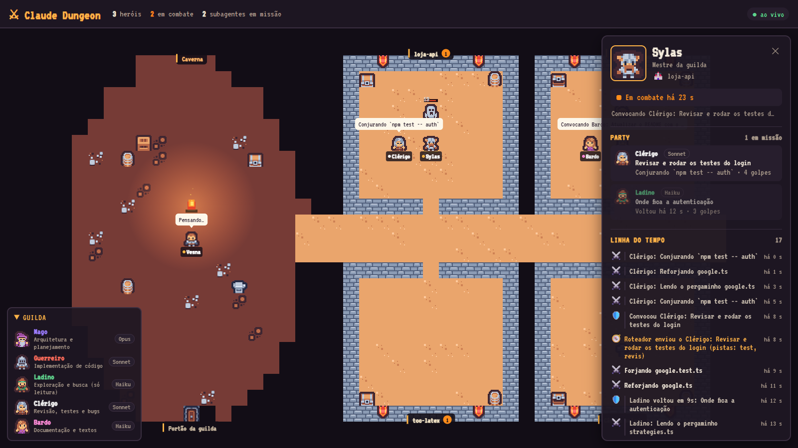
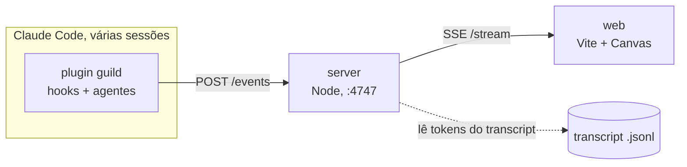

# ⚔ Claude Dungeon

Veja suas sessões do [Claude Code](https://claude.com/claude-code) como uma guilda de RPG explorando uma dungeon em pixel art, ao vivo.



- Cada **sessão** do Claude é um **herói** com nome e visual próprios.
- Cada **projeto** (a pasta onde a sessão roda) é uma **sala da dungeon**, com placa e contador de heróis.
- Quem está trabalhando entra na sala e **luta com o monstro**: cada chamada de ferramenta (ler um arquivo, rodar um comando) é um golpe.
- Quem terminou volta para **descansar na caverna**, em volta da fogueira. Quem precisa da sua permissão fica com um balão amarelo de **"!"**.
- Clicar num herói abre o **painel lateral**:
  - status ("Em combate há 3 min");
  - **party** (os subagentes que ele convocou);
  - **linha do tempo**;
  - **estatísticas**: chamadas, tokens, modelo, duração.

## Inteligência direcionada: a guilda

Além de mostrar, o projeto **decide quem faz o quê**, como no [ruflo](https://github.com/ruvnet/ruflo): cada tipo de tarefa vai para uma classe especializada, cada uma num modelo escolhido pelo custo e benefício daquele trabalho.

| Classe | Papel | Modelo | Ferramentas |
| --- | --- | --- | --- |
| 🧙 Mago | arquitetura e planejamento | Opus | só leitura + web |
| 🛡️ Guerreiro | implementação | Sonnet | todas |
| 🗡️ Ladino | explorar e buscar no código | Haiku | Read, Grep, Glob |
| ✨ Clérigo | revisão, testes e bugs | Sonnet | leitura, Bash, Edit |
| 🎻 Bardo | documentação e textos | Haiku | leitura, Write, Edit |

O roteamento tem duas camadas:

1. **Instrução**: ao abrir a sessão, um hook diz ao Claude principal que ele é o *Mestre da guilda* e passa a tabela acima.
2. **Roteador**: quando o Claude chama um subagente genérico (`general-purpose`), um hook `PreToolUse` lê a descrição da tarefa e troca o tipo pela classe certa, com pesos por palavra-chave em português e inglês ([`plugin/hooks/router.mjs`](plugin/hooks/router.mjs)). A decisão aparece na linha do tempo:

   > 🧭 Roteador enviou o Ladino: Onde fica a função classify (pistas: onde fica, procur)

   Na prática, uma busca simples que iria para o modelo da sessão vai para o Haiku, mais rápido e mais barato.

## Como funciona



- **`plugin/`**: plugin do Claude Code.
  - Hooks de comando (`SessionStart`, `UserPromptSubmit`, `PreToolUse`, `PostToolUse`, `SubagentStart/Stop`, `Notification`, `Stop`, `SessionEnd`) mandam cada evento ao servidor. Antes, cortam o conteúdo dos arquivos e prompts: só vai o que o mapa mostra.
  - Se o servidor estiver desligado, o hook desiste em 0,7 s e a sessão segue normal.
  - Os 5 agentes ficam em `plugin/agents/`.
- **`server/`**: `node:http` puro, com três rotas: `POST /events`, `GET /state` e `GET /stream` (Server-Sent Events).
  - O estado sai de um **reducer puro** (`reduce(state, event) → state`), testado sem rede nem disco.
  - No fim de cada resposta, ele lê o transcript da sessão para somar tokens e descobrir o modelo.
  - O estado é salvo em `data/world.json`.
- **`web/`**: Canvas 2D sem engine de jogo.
  - O mapa é gerado a partir dos projetos ativos (determinístico, com PRNG semeado).
  - Os heróis andam com **A\*** (heap binário, heurística de Manhattan).
  - O zoom é inteiro, para o pixel ficar nítido.
  - Os balões se empilham quando se sobrepõem.
- **`shared/`**: tipos e a tabela da guilda, usados pelo servidor e pelo mapa.

## Rodar

Pré-requisitos: Node 20+ e o Claude Code.

```bash
npm install
npm run dev          # servidor em :4747 e mapa em http://localhost:5173 (ou a próxima porta livre, que o Vite mostra)
```

Sem o Claude, dá para ver o mapa com sessões simuladas (que passam pelo roteador de verdade):

```bash
npm run demo             # uma rodada
npm run demo -- --loop   # sem parar
```

### Ligar no Claude Code

Instale o plugin a partir deste repositório (ele é o próprio marketplace):

```bash
claude plugin marketplace add <caminho-ou-usuario/repo>
claude plugin install guild@claude-dungeon
```

A partir daí, toda sessão nova aparece no mapa enquanto o servidor estiver rodando.

| Variável | Para quê |
| --- | --- |
| `CLAUDE_DUNGEON_URL` | endereço do servidor (padrão `http://127.0.0.1:4747`) |
| `GUILD_ROUTER=off` | só observa: o roteador não troca o tipo de nenhum subagente |
| `PORT` | porta do servidor |

`npm start` faz o build do mapa e serve tudo pelo servidor, em http://localhost:4747.

## Testes

```bash
npm test         # Vitest: roteador, reducer, transcript, A*, mapa, formatação
npm run typecheck
```

## Decisões técnicas

- **Por que hooks de comando e não um MCP?** Os hooks veem tudo o que acontece na sessão, inclusive as chamadas dos subagentes, sem o modelo precisar fazer nada. Um MCP só veria o que o modelo escolhesse chamar.
- **Por que SSE e não WebSocket?** O fluxo é de mão única (servidor → mapa), e o `EventSource` reconecta sozinho, sem nenhuma dependência.
- **Por que mandar o estado inteiro a cada mudança?** Ele é pequeno (a linha do tempo tem limite), e assim o cliente não precisa aplicar diffs nem tratar mensagens perdidas. As rajadas de eventos são agrupadas em uma mensagem a cada 100 ms.
- **Por que reducer puro?** Toda a regra do jogo (quem está em combate, quem é da party de quem) fica num lugar só, testável com uma lista de eventos.
- **Por que o roteador é por palavras-chave e não um LLM?** Ele roda em cada chamada de subagente, dentro de um hook. Precisa ser instantâneo, grátis e previsível. O Claude principal já recebe a tabela da guilda e escolhe a classe sozinho na maioria das vezes; o roteador só cobre as chamadas genéricas.

## Créditos

- Arte: [Tiny Dungeon](https://kenney.nl/assets/tiny-dungeon), de Kenney (CC0), em `web/public/assets/`.
- Fonte: [VT323](https://fonts.google.com/specimen/VT323) (OFL).
- Ideia do roteamento por especialista: [ruflo](https://github.com/ruvnet/ruflo).

## Próximos passos

- Classificador opcional por embeddings no roteador, com o de palavras-chave como reserva.
- Custo estimado por sessão e por classe.
- Sons (golpe, vitória) e um modo "TV" que segue o herói ativo.
